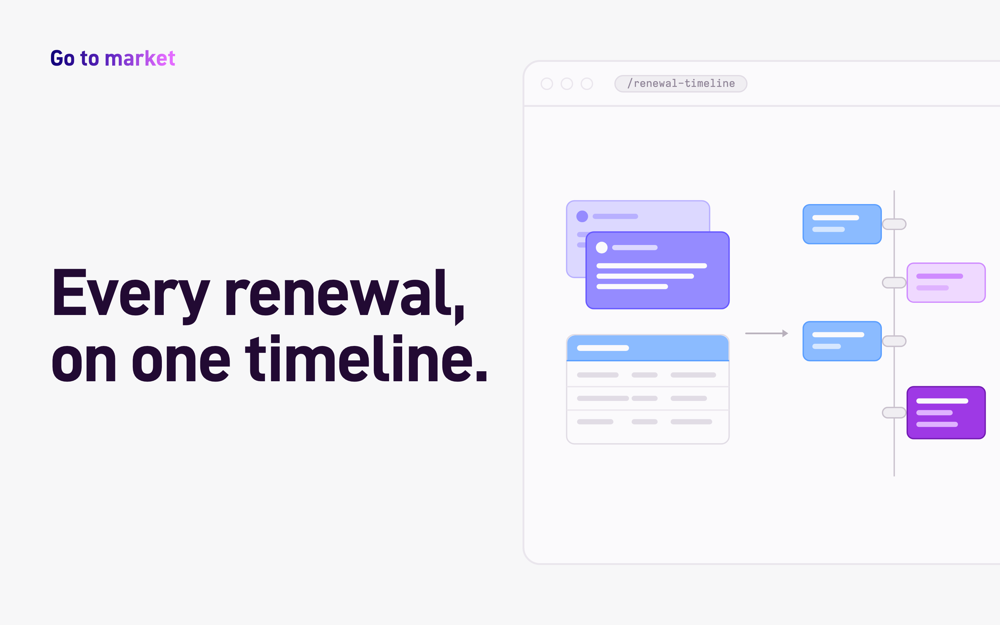

# Skill covers

Every skill has a cover: a 1600x1000 image, saved at 2x, at the top of the skill's guide,
and on its card and page on whimsical.com. All covers share one layout, `template.html`; what
changes per skill is a two-line text spec and one illustration. The page around the cover
already says what the skill does and shows a prompt, so the cover only names the skill's
promise and shows it.



## Make a cover

For a skill named `<name>`:

1. Write `<name>.json`:

   ```json
   {
     "category": "Go to market",
     "headline": "Every renewal,\non one timeline."
   }
   ```

   - `category`: the kind of work, in two or three words and sentence case, like
     `Wireframes` or `Go to market`.
   - `headline`: the promise, in at most two lines of about 15 characters each. Put the
     line break in yourself with `\n`.

2. Draw `art/<name>.svg`, following the style below.
3. Render it, then look at `<name>.png` before committing it:

   ```sh
   uv run --with playwright playwright install chromium   # once
   uv run docs/covers/render.py <name>
   ```

`tests/repo/` checks that every skill has all three files and that the PNG is the right
size. Commit the PNG, and put it at the top of the skill's guide, above its title:
``. The website reads it from the repository at the latest
release.

## Drawing the illustration

The illustration shows the skill's input turning into its output, drawn like the
illustrations on whimsical.com's tool cards. Open `art/app-wireframe.svg` and
`art/renewal-timeline.svg` first and match them.

- **Canvas**: `viewBox="0 0 720 520"`, `fill="none"` on the root. The template puts it in
  a browser window that runs off the right edge, so keep everything inside x 40 to 690.
- **Composition**: input on the left, a gray arrow, output on the right, centered on
  y 260. One input and one output; if the skill reads two sources, stack them on the
  left, as renewal-timeline does with email and CRM.
- **Shapes**: flat rounded rectangles (`rx` 8 to 18) filled with a light tint and
  outlined, `stroke-width="2"`, in a darker shade of the same hue. No gradients, no
  shadows, no icons from icon sets.
- **Text**: never real words. Text is a rounded bar, 8 high (`rx="4"`), or 12 high for a
  title, in a shade of its container's hue, or white on a strong fill.
- **The arrow**: `<path d="M322 260H392" stroke="#b8b0bc" stroke-width="2.5"
  stroke-linecap="round"/>` with a small triangle head, as in both examples.
- **Color**: the input usually takes the color of where the data lives, the output is
  Whimsical: purple for what the skill creates, a solid `#9e39e5` card for the result
  that matters most. Gray for anything that is structure rather than content.

- **Purple**: fills `#efd9ff` and `#dfb2ff`, border `#cf8bff`; strong `#9e39e5` with
  border `#731bb2`.
- **Blue**: fill `#8bbbff`, border `#5a9eff`, bars `#fbfafc` and `#d6e7ff`.
- **Periwinkle**: fills `#dcd8ff`, `#b8b0ff` and `#958bff`, border `#6658ff`.
- **Gray**: fills `#f0eef2` and `#f6f4f8`, borders and bars `#e1dce5` and `#d6d0db`,
  connectors `#c9c1cd`, strong `#b8b0bc`.
- **Canvas**: `#fbfafc`, lines `#eae6ed`.

These are the colors of whimsical.com. Don't add new ones; if a skill needs another hue,
ask whoever owns the website's design.

## Fonts

The headline is set in Dinsical and everything else in Monsical, Whimsical's open-source
fonts. `template.html` loads them from [WhimsicalCode/fonts](https://github.com/WhimsicalCode/fonts),
so rendering needs an internet connection.
