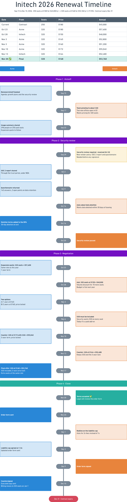

# Renewal Timeline

Turn the emails behind a customer, client or contract renewal into a timeline in
[Whimsical](https://whimsical.com), and a renewal summary to go with it.

```text
Build the renewal timeline for Initech
```

Your agent reads the renewal threads in your email or CRM and lays out every step on a board:
your side on the left, the customer's on the right, each offer and counter-offer with its
price, the contract expiry date, and what's still open. A pricing table at the top shows how
the negotiation moved, with the agreed terms highlighted. The summary covers the deal terms,
NRR, usage if you have the numbers, and the open items.



This is a new project, and most of it was written by coding agents. We've used it at
Whimsical on real renewals, in Claude Code and on claude.ai, but it hasn't been tested much
with other agents or tools. If something breaks, please
[open an issue](https://github.com/WhimsicalCode/skills/issues/new/choose).

## Who it's for

It's for B2B renewals: a subscription, license or service agreement coming up for renewal,
where you and your customer go back and forth on seats, price and terms before signing.
Account executives, customer success and account managers, and deal desks use it to see
where a renewal stands before a call, or to hand an account over to someone new.

The renewal in the screenshot is made up, but typical: 22 steps over three months, from the
kickoff call through a security review and seven price proposals to the countersigned order
form. That was dozens of emails spread over several threads. The board fits it on one
page.

It works with seat-based SaaS pricing, flat fees, monthly retainers and one-off project fees.
It's not meant for renewals you handle as a buyer, or for domain names, licenses and
subscriptions that renew on their own.

## What you'll get

A new board called `<Customer> <Year> Renewal Timeline`:

- **The negotiation at a glance**: a pricing table with every offer and counter-offer, oldest
  first, the current contract on top and the agreed row in green.
- **The story**: one card per meaningful step, grouped into phases ("Finding the owner",
  "Negotiation", "Close"), with a date on each. Key moments are filled, the acceptance is
  green, and anything blocking the deal is yellow until it's resolved.
- **The deadline**: the contract's expiry date sits on the timeline at its date, so a late
  signature shows up as one.

And a renewal summary in chat: the new terms, NRR and the change in revenue, usage against what's
billed, what the customer said versus what the numbers show, the negotiation step by step,
and the open items.

Ask again later, with new emails or a few lines of what happened, and the agent adds the new
steps to the same board.

## Requirements

- An agent that supports skills and remote MCP servers, such as
  [Claude Code](https://claude.com/claude-code), the Claude apps, Codex or Cursor.
- A [Whimsical](https://whimsical.com) account, connected through the
  [Whimsical MCP](https://whimsical.com/learn/integrations/mcp).
- Your renewal conversations: an email or CRM connector your agent can use (Gmail, Outlook,
  Front, HubSpot, Salesforce and others), or a thread you paste or export.
- Python 3.9 or later, with nothing to install. Most Macs and Linux machines have it, and so
  does Claude's sandbox; on a Mac that doesn't, the first run offers to install Apple's
  command line tools.

Usage numbers are optional. If you have them (an admin dashboard, a BI tool), the summary
uses them; it never guesses.

## Install

The skill needs one MCP server, Whimsical: `https://mcp.whimsical.com/mcp`. Your email or CRM
connector is whatever your agent already uses.

### Claude Code

With [Node.js](https://nodejs.org) installed, run this in a terminal:

```sh
npx skills add WhimsicalCode/skills --skill renewal-timeline --agent claude-code -g
claude mcp add --transport http --scope user whimsical https://mcp.whimsical.com/mcp
```

`-g` makes the skill available in every folder. Skip the `claude mcp add` line if
`claude mcp list` already shows Whimsical. Then start Claude Code, run `/mcp`, and sign in
to Whimsical.

Or install it as a plugin, which adds the Whimsical MCP server for you:

```text
/plugin marketplace add WhimsicalCode/skills
/plugin install renewal-timeline@whimsical
```

If you already had Whimsical configured, you'll see it twice in `/mcp`; disable one.

### Claude apps (claude.ai and the desktop app)

1. Download
   [`renewal-timeline.zip`](https://github.com/WhimsicalCode/skills/releases/latest/download/renewal-timeline.zip).
2. In Claude, open **Customize** (on claude.ai, [claude.ai/customize/skills](https://claude.ai/customize/skills)),
   click **Add**, then **Upload skill**, drop the zip and click **Upload**.
3. Still in **Customize**, under **Connectors**, add Whimsical, and the connector for your
   email or CRM.

### Cursor, Codex, GitHub Copilot, Gemini CLI and other agents

With [Node.js](https://nodejs.org) installed, run this in a terminal:

```sh
npx skills add WhimsicalCode/skills --skill renewal-timeline --agent cursor -g
```

Replace `cursor` with `codex`, `github-copilot`, `gemini-cli` or
[another agent's name](https://github.com/vercel-labs/skills/blob/main/docs/agents.md).
This copies the skill where your agent looks for skills, using the open
[skills](https://github.com/vercel-labs/skills) installer. Without Node.js, unzip
[`renewal-timeline.zip`](https://github.com/WhimsicalCode/skills/releases/latest/download/renewal-timeline.zip)
into that folder yourself. Either way, then add the Whimsical MCP server following your
agent's MCP guide, or [Whimsical's](https://whimsical.com/learn/integrations/mcp).

## Use it

Start your agent in the folder where you want the working files, then ask in plain language:

```text
Build the renewal timeline for Initech
Look at the emails and update the Initech renewal board
Update https://whimsical.com/<board>: Initech signed the order form today
Make a renewal timeline from ./events.json
```

Each customer gets a folder, `renewals/<Customer>/`, with `events.json`: everything the agent
found, in order, with every price. The next update starts from it, so keep the folder. It
holds customer details, so if you're working in a git repository, keep `renewals/` out of it.

The agent builds a new board unless you name one, with a link or "update the Initech
renewal board". It will probably ask permission for each tool the first time. Allowing the
Whimsical tools and `python3` for the session keeps it moving.

## How it works

```text
 email / CRM / pasted thread  ─►  events.json  ─►  build_board.py  ─►  Whimsical board
 usage numbers (optional)     ─┘       │
                                       └──────────►  renewal summary
```

1. The agent finds the customer's renewal threads and reads the full messages, not
   previews, since previews cut numbers off.
2. It writes one file, `events.json`: each meaningful step in order, with the price of every
   offer. The format is in
   [`references/event-schema.md`](../skills/renewal-timeline/references/event-schema.md); a
   full example is
   [`examples/full-deal.example.json`](../skills/renewal-timeline/examples/full-deal.example.json).
3. `build_board.py` checks the file and reports every problem at once. Then it works out the
   whole board: positions, colors, the pricing table, the subtitle and the deal numbers. It
   prints the exact Whimsical calls, and the agent passes them on as they are, so a board
   comes out the same every time.
4. The agent checks a snapshot of the board, then writes the summary from the same file, so
   the board and the summary agree.

To update a board, the script asks for a short read of it (about ten objects), adds only the
new steps, and moves the expiry date and the end of the timeline.

`build_board.py` uses only Python's standard library and never touches the network: the agent
talks to Whimsical and hands the results to the script.

## Questions

**Does it work if our pricing isn't per seat?** Yes. Each offer needs a total; seats and a
price per seat are optional. Tiered prices, flat fees, monthly retainers and project fees
all fit, and the pricing table labels the amounts to match.

**Can it show a downsell or churn risk, not only an expansion?** Yes. The summary gives the
change in revenue and NRR either way, and when the customer cuts seats it sets what they
said next to the usage numbers, if you have them.

**Does it change anything in our CRM or send emails?** No. It only reads your email and CRM.
The one thing it writes is the Whimsical board.

**Can several people work on the same renewal?** The board is a normal Whimsical board, so
your team can comment on it and share it. Updates work best when they come from the same
`renewals/<Customer>/` folder, since `events.json` there is what the next update builds on.

## Privacy

The skill doesn't collect anything. It only reads your email and CRM, and never sends a
message or changes a record unless you ask it to. Boards get short summaries, not email
bodies. Email and CRM content is treated as data, never as instructions to the agent. Your
agent talks to Whimsical through its MCP server, under
[Whimsical's privacy policy](https://whimsical.com/terms/privacy).

## Development

```text
skills/renewal-timeline/
  SKILL.md                 the workflow the agent follows
  references/
    event-schema.md        the events.json format
    board-layout.md        what the board looks like, element by element
    summary-template.md    the summary's structure
  scripts/
    build_board.py         checks events.json, writes the Whimsical calls
  examples/                a small example and a full deal, both fictional
tests/renewal-timeline/    tests for the script (fixtures/: a real board read, fictional data)
```

Its Claude Code plugin entry, with the Whimsical MCP server, is in the repository's
[`marketplace.json`](../.claude-plugin/marketplace.json). From the repository root:

```sh
uv run --group dev pytest tests/renewal-timeline
```

The script must keep running on Python 3.9, which a test checks. [CONTRIBUTING.md](../CONTRIBUTING.md)
covers the rest.

## License

[MIT](../LICENSE)
