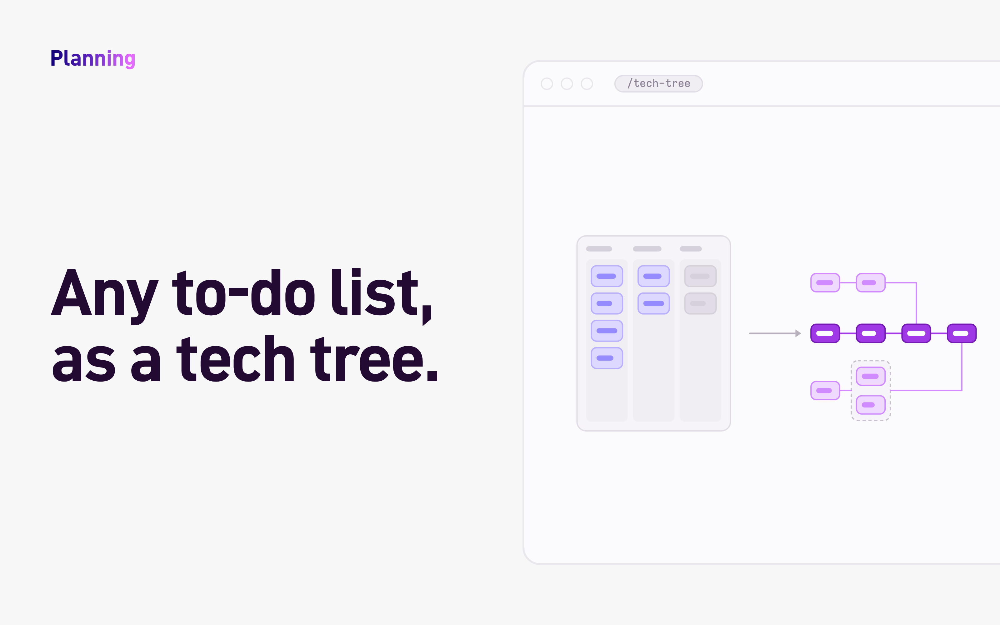

# Tech Tree

Turn any list of tasks into a tech tree in [Whimsical](https://whimsical.com). Start from a
Whimsical board, a kanban, a markdown or text to-do list, Linear issues or another tool. Each
task sits right after what it needs, so you see at a glance what you can start now, what's
waiting, what can happen in parallel, and the critical path.

```text
Turn this board into a tech tree: https://whimsical.com/acme-launch-...
```


Your agent reads every task, works out which tasks block which, checks the dependencies it
inferred with you, and draws the tree on a new board, laid out like a metro map: lines of tasks
run left to right, and arrows bend as little as they can and cross as rarely as they can.

## Any list of tasks

All the skill needs is a list of tasks. Your agent reads them, from wherever they are, into one
simple file, and the tree is drawn from that file, so every list works the same way:

- **Tasks**: one card each, with the task's title.
- **Status**: finished is done, started is in progress, the rest is to do. A ticked box (`[x]`)
  is done. A list with no status at all is all to do.
- **Dependencies**: the ones the list states first, like an arrow, a "blocked by" link or a task
  that says "after the lease is signed". Then the agent's judgement, for tasks that plainly can't
  start before another is done. Most to-do lists state none, so there the tree rests on the
  agent's judgement, and it says so.
- **Groups**: similar tasks to do side by side, like the shopping before a recipe.

The agent only adds a dependency of its own when a task can't start without the other, and shows
you those, with why, before drawing. Nothing in the list is changed: the tree goes on a new
board.

## Where the tasks can come from

### A file or a list you paste

A markdown to-do list, a checklist, notes from a meeting: paste it, or point the agent to the
file. Nothing else to connect.

### A Whimsical board

The board you're planning on, through the Whimsical MCP the skill already uses.

- **Tasks** are the board's cards. Sticky notes, text and shapes aren't tasks; if the board has
  only those, the agent asks before using them.
- **Status** comes from the cards' columns: Done, Shipped or Live is done; In progress, Review or
  QA is in progress; anything else is to do. A done tag or a fully ticked checklist counts too.
- **Dependencies** come from arrows already on the board, from what the cards say ("after the
  API is live", "blocked by legal"), and from the agent's judgement.
- **Groups** come from rectangles already drawn around cards, and from the agent's judgement.

### Linear

The issues of a project, a cycle, a team or a label, or the issues you list or link, through
the [Linear MCP](https://linear.app/docs/mcp). The skill has a guide for reading it:

- **Status** comes from each issue's workflow state. Canceled and duplicate issues are left out.
- **Dependencies** come from the issues' "blocks" and "blocked by" relations. An issue from
  outside the set that blocks one in it is drawn too, and the agent tells you which.
- **Groups** come from sub-issues of one parent.
- Each card starts with the issue's identifier (`ENG-142`) and links to it.

### Any other tool

Todoist, Asana, Jira, GitHub issues and the like, through whatever MCP server or connector your
agent has for them. The agent reads the tasks with the tools it has, uses the tool's "blocked
by" links if it has them, and links each card to its task when the tool gives tasks an address.

## What you'll get

A new board called `<Board, list or project> tech tree`, with:

- **Every task as a card**, one column after the last thing it needs. Cards are coloured by where
  they stand: green to start now, yellow in progress, white waiting, grey done.
- **An arrow from each task to what needs it.** Only direct needs: if C needs B and B needs A,
  there's no arrow from A to C.
- **Groups** in a dashed rectangle with a label. One arrow to the rectangle stands for an arrow
  to each of its cards.
- **The critical path** in orange, drawn on top: the longest chain of unfinished tasks, the one
  that decides how soon it's all done.
- **A key** above the tree, and a line saying how long it took.

## How it lays out the tree

A tech tree is only useful if you can follow its arrows, so the layout is built for that, with
one priority above all: as few crossing arrows as it can, then as few bends.

1. **Columns.** Each task goes one column after the last thing it needs, with the arrows as short
   as they can be (network simplex, as in Graphviz).
2. **Order.** Within each column, cards are ordered to cross as few arrows as possible, the way
   Graphviz and Mermaid order theirs.
3. **Rows.** Keeping that order, cards take rows that line up as many arrows as possible, so they
   run straight, like lines on a metro map. The critical path starts on one row.
4. **Arrows.** Each arrow is one of the shapes Whimsical draws by itself: straight, an L with one
   bend, or a Z or U with two. Arrows never cross a card, and never run along another arrow:
   each side of a card has a few slots, one arrow each.
5. **Polish.** Last, cards are moved the way a person tidying the board would: to a better row, a
   swap with a card in their column, or onto another card's row, pushing it aside. A move stays
   if the tree gets clearer.

If an arrow still can't avoid a card, it's drawn red and the agent looks at it. On the trees
we've tried, none were left.

## Status

This is a new project, written mostly by coding agents. We've tried it in Claude Code on
Whimsical boards of 15 to 30 tasks, on a pasted markdown to-do list, and on a small Linear
project with blocking relations, sub-issues and a blocker from outside the project. Not yet on
other tools. In Codex, it reads the tasks and lays the tree out, but can't draw it yet: Codex
doesn't offer the Whimsical MCP's `edit` tool, which the drawing needs. If something breaks,
please [open an issue](https://github.com/WhimsicalCode/skills/issues/new/choose).

## Requirements

- An agent that supports skills and remote MCP servers, such as
  [Claude Code](https://claude.com/claude-code) or Cursor.
- A [Whimsical](https://whimsical.com) account, connected through the
  [Whimsical MCP](https://whimsical.com/learn/integrations/mcp).
- Python 3.9 or later, with nothing to install.

To read tasks from Linear or another tool, your agent also needs that tool's MCP server or
connector, such as the [Linear MCP](https://linear.app/docs/mcp). A board, a file or a pasted
list needs nothing more.

## Install

The skill needs one MCP server, Whimsical: `https://mcp.whimsical.com/mcp`. To read tasks from
Linear or another tool, add that tool's MCP server too.

### Claude Code

With [Node.js](https://nodejs.org) installed, run this in a terminal:

```sh
npx skills add WhimsicalCode/skills --skill tech-tree --agent claude-code -g
claude mcp add --transport http --scope user whimsical https://mcp.whimsical.com/mcp
```

`-g` makes the skill available in every folder. Skip the `claude mcp add` line if
`claude mcp list` already shows Whimsical. Then start Claude Code, run `/mcp`, and sign in
to Whimsical.

Or install it as a plugin, which adds the Whimsical MCP server for you:

```text
/plugin marketplace add WhimsicalCode/skills
/plugin install tech-tree@whimsical
```

If you already had Whimsical configured, you'll see it twice in `/mcp`; disable one.

To read Linear issues, add Linear's MCP server the same way, then sign in to it in `/mcp`:

```sh
claude mcp add --transport http --scope user linear https://mcp.linear.app/mcp
```

### Claude apps (claude.ai and the desktop app)

Not tested there yet. If you try it, please
[tell us how it went](https://github.com/WhimsicalCode/skills/issues).

1. Download
   [`tech-tree.zip`](https://github.com/WhimsicalCode/skills/releases/latest/download/tech-tree.zip).
2. In Claude, open **Customize** (on claude.ai, [claude.ai/customize/skills](https://claude.ai/customize/skills)),
   click **Add**, then **Upload skill**, drop the zip and click **Upload**.
3. Still in **Customize**, under **Connectors**, add Whimsical, and the connector for
   Linear or any other tool you'll read tasks from.

### Other agents (Cursor, Codex, GitHub Copilot, Gemini CLI and more)

With [Node.js](https://nodejs.org) installed, run this in a terminal:

```sh
npx skills add WhimsicalCode/skills --skill tech-tree --agent cursor -g
```

Replace `cursor` with `codex`, `github-copilot`, `gemini-cli` or
[another agent's name](https://github.com/vercel-labs/skills/blob/main/docs/agents.md).
This copies the skill where your agent looks for skills, using the open
[skills](https://github.com/vercel-labs/skills) installer. Without Node.js, unzip
[`tech-tree.zip`](https://github.com/WhimsicalCode/skills/releases/latest/download/tech-tree.zip)
into that folder yourself. Either way, then add the Whimsical MCP server following your agent's MCP guide, or
[Whimsical's](https://whimsical.com/learn/integrations/mcp), and the MCP server of any tool
you'll read tasks from, like [Linear's](https://linear.app/docs/mcp).

## Use it

Start your agent in the folder where you want the working files, then ask in plain language:

```text
Turn this board into a tech tree: https://whimsical.com/...
What order should we do these tasks in? https://whimsical.com/...
Make a tech tree of this to-do list: [x] Sign the lease  [ ] Pick a mover  [ ] Move day ...
Make a tech tree of the tasks in ./launch-plan.md
Make a tech tree of our Q3 launch project in Linear
What's blocking what in the current cycle of the Platform team?
Make a tech tree of my Todoist project "Office move"
```

The agent shows you the dependencies it inferred before drawing; say what's wrong and it
redraws the plan. To skip that, say so ("don't ask, I'll review the board"). It will probably
ask permission for each tool the first time; allowing the Whimsical tools, those of the tool
you read tasks from, and `python3` for the session keeps it moving.

Each list gets a folder, `tech-trees/<name>/`: the agent's reading of it (`tree.json`) and the
layout (`plan.json`). To redraw after a change, ask again: the agent updates `tree.json` and
draws the tree on a new board.

## How it works

```text
 any list of tasks:                                    tree.json
 a board, a file,  ─►  your agent reads the tasks  ─►  (tasks, groups, dependencies)
 Linear, ...                                              │
                                                          ▼
                                                   techtree.py layout  ─►  plan.json
                                                                              │
                                                                              ▼
                                                          new Whimsical board, drawn as planned
```

1. The agent reads the tasks and writes `tree.json`: every task with its status, the groups,
   and the dependencies. That file is the only thing the layout needs, so any source works;
   [`tree-format.md`](../skills/tech-tree/references/tree-format.md) describes it.
2. `techtree.py layout` checks it (unknown ids, loops), drops implied arrows, finds the critical
   path and lays the tree out, deterministically: the same tree always gets the same drawing.
   It writes every card, rectangle and arrow as Whimsical edit operations.
3. The agent creates the board and sends the operations as they are, then adds the footer and
   checks a snapshot.

The script uses only Python's standard library and never calls Whimsical or any other tool.

## Privacy

The skill doesn't collect anything, and its script doesn't use the network. Your agent reads
and draws boards through Whimsical's MCP server, under
[Whimsical's privacy policy](https://whimsical.com/terms/privacy), and reads tasks from Linear or
another tool through that tool's MCP server, under its own privacy policy. It never changes the
tasks it reads. Task titles, descriptions and comments are treated as data, never as
instructions to the agent.

## License

[MIT](../LICENSE)
