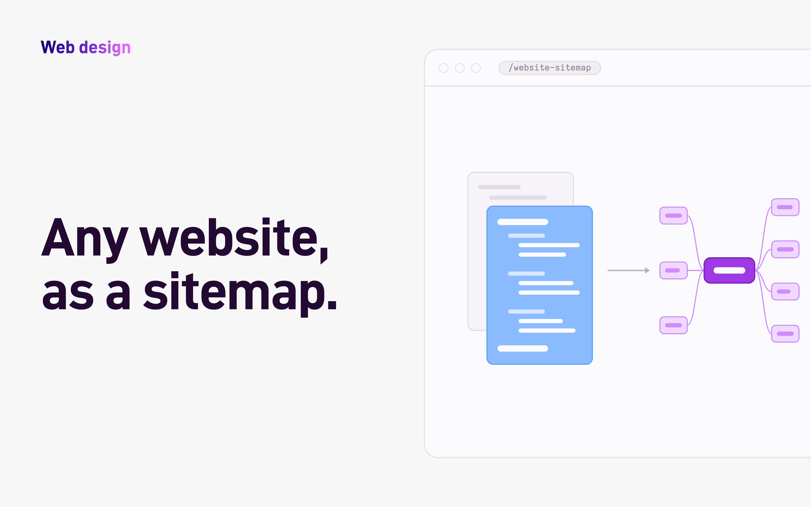
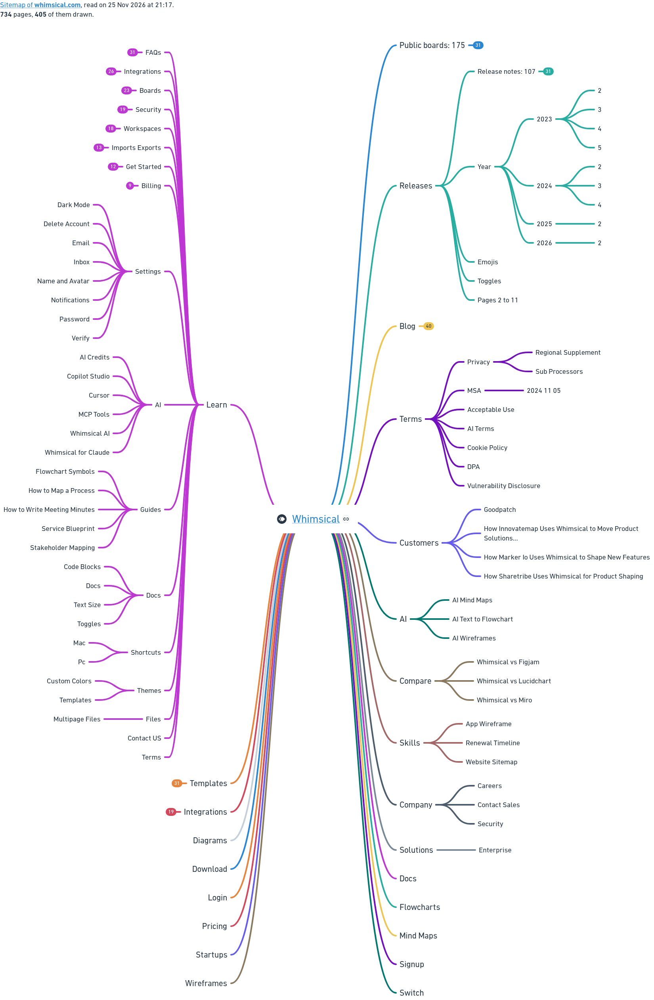

# Website Sitemap

Draw any website's sitemap in [Whimsical](https://whimsical.com), straight from its
sitemap.xml: a mind map for the quickest overview, or a flowchart with a table per section
for planning a build.

```text
Make a sitemap of acme.com
```



Your agent reads the site's sitemap, and every sitemap nested in it, and asks which diagram you
want. Then it draws the site on a new board, top down: its main pages and sections first,
with pages made from one pattern grouped ("globex.com and 261 others", "Pages 2 to 23") and
long lists cut at 30, the rest counted. Thousands of blog posts or event sessions don't bury
the structure, and even big sites fit on one board.

## What it reads from

The site's sitemap, and every sitemap nested in it. Nothing else: it doesn't open the pages
themselves, and needs no other tool or account.

The site has to publish a sitemap: listed in its robots.txt, or at `/sitemap.xml` or
`/sitemap_index.xml`. Most sites built on a CMS or a site builder do. If there's none, the agent
says so and stops; it never crawls the site or guesses its pages.

## What you'll get

A new board called `<Site> sitemap`, with one of:

- **A mind map**: the site's name in the middle, each section a branch, each page a node.
  Branches are spread on both sides of the root.
- **A flowchart**: the site's name at the top, a table per section listing its pages, and an
  arrow from each section to its subsections.

Or both, side by side. The root links to the site, with its logo when Whimsical's icon set
has it (Stripe and GitHub do; most sites don't, and Whimsical can't show favicons). Above the
diagram, a short text says how long the drawing took, links to the sitemap with the time it
was read, and says how many of the sitemap's pages are drawn.

Labels come from the URLs (`/data-center` becomes "Data Center"), and the agent fixes the
brand names and acronyms a URL loses, like "AcmePay" or "GlobexDB". The drawing follows the URLs,
not the site's menus, so its sections can differ from what the navigation shows.

## Requirements

- An agent that supports skills and remote MCP servers, such as
  [Claude Code](https://claude.com/claude-code), Codex or Cursor.
- A [Whimsical](https://whimsical.com) account, connected through the
  [Whimsical MCP](https://whimsical.com/learn/integrations/mcp).
- Python 3.9 or later, with nothing to install, and internet access for the agent's
  commands, to read the sitemap.

## Install

The skill needs one MCP server, Whimsical: `https://mcp.whimsical.com/mcp`.

### Claude Code

With [Node.js](https://nodejs.org) installed, run this in a terminal:

```sh
npx skills add WhimsicalCode/skills --skill website-sitemap --agent claude-code -g
claude mcp add --transport http --scope user whimsical https://mcp.whimsical.com/mcp
```

`-g` makes the skill available in every folder. Skip the `claude mcp add` line if
`claude mcp list` already shows Whimsical. Then start Claude Code, run `/mcp`, and sign in
to Whimsical.

Or install it as a plugin, which adds the Whimsical MCP server for you:

```text
/plugin marketplace add WhimsicalCode/skills
/plugin install website-sitemap@whimsical
```

If you already had Whimsical configured, you'll see it twice in `/mcp`; disable one.

### Claude apps (claude.ai and the desktop app)

Not tested there yet. The skill reads the sitemap from the site itself, and Claude's
sandbox may not allow that. If you try it, please
[tell us how it went](https://github.com/WhimsicalCode/skills/issues).

1. Download
   [`website-sitemap.zip`](https://github.com/WhimsicalCode/skills/releases/latest/download/website-sitemap.zip).
2. In Claude, open **Customize** (on claude.ai, [claude.ai/customize/skills](https://claude.ai/customize/skills)),
   click **Add**, then **Upload skill**, drop the zip and click **Upload**.
3. Still in **Customize**, under **Connectors**, add Whimsical.

### Other agents (Cursor, Codex, GitHub Copilot, Gemini CLI and more)

With [Node.js](https://nodejs.org) installed, run this in a terminal:

```sh
npx skills add WhimsicalCode/skills --skill website-sitemap --agent cursor -g
```

Replace `cursor` with `codex`, `github-copilot`, `gemini-cli` or
[another agent's name](https://github.com/vercel-labs/skills/blob/main/docs/agents.md).
This copies the skill where your agent looks for skills, using the open
[skills](https://github.com/vercel-labs/skills) installer. Without Node.js, unzip
[`website-sitemap.zip`](https://github.com/WhimsicalCode/skills/releases/latest/download/website-sitemap.zip)
into that folder yourself. Either way, then add the Whimsical MCP server following your
agent's MCP guide, or [Whimsical's](https://whimsical.com/learn/integrations/mcp).

## Use it

Start your agent in the folder where you want the working files, then ask in plain language:

```text
Make a sitemap of acme.com
Draw the site structure of https://www.globex.com as a flowchart
Mind map the sitemap of initech.com, in German
Draw just the /blog section of acme.com's sitemap
Make a sitemap of acme.com with up to 60 pages per section
Make a quick sitemap of acme.com, 200 nodes at most
```

The agent asks which diagram you want unless you say. It will probably ask permission for
each tool the first time; allowing the Whimsical tools and `python3` for the session keeps it
moving.

Each site gets a folder, `sitemaps/<domain>/`: every page URL from the sitemap
(`pages.txt`), what was read (`sitemaps.json`), the label fixes (`labels.json`) and the
diagram text. Ask again for the same site and it starts from there, without reading the
sitemap again unless you ask for fresh data.

### Draw more or less

The defaults fit most sites. Ask for other sizes in plain words, and the agent sets them:

| | Default | You can ask for | For example |
|---|---|---|---|
| Nodes in the whole diagram | 1,000 | 2 to 2,000 in a mind map, up to 1,000 in a flowchart | "300 nodes at most" |
| Entries under one node, before "and N other pages" | 30 | 1 to 199 | "up to 60 pages per section" |
| Mind map lists that start collapsed | more than 8 pages | any size, or none | "keep every branch open" |

The highest values are what the Whimsical MCP takes in one go: 2,000 nodes in a mind map,
1,000 in a flowchart, and 200 rows in a flowchart's table. Bigger diagrams take longer to draw
and to open.

## How it works

```text
 robots.txt, sitemap.xml  ─►  sitemap.py fetch  ─►  pages.txt
                                                       │
 labels.json  ─────────────►  sitemap.py draw   ◄──────┘
                                     │
                                     ▼
                      mindmap.md or flowchart.mmd  ─►  Whimsical board
```

1. `sitemap.py fetch` finds the sitemap, reads it and every nested sitemap (gzipped ones
   too), and saves the page URLs.
2. `sitemap.py draw` builds the tree of pages, keeps one language, groups collections, chooses
   what fits in 1,000 nodes, top down, and writes the diagram as compact text: an indented outline
   for the mind map, a Mermaid class diagram for the flowchart. A 1,000-node sitemap is about
   6,000 tokens.
3. The agent fixes labels, creates the board and passes the text to the Whimsical MCP as is.
   Whimsical lays the diagram out. The agent then spreads the mind map's branches on both
   sides, collapses its long lists, adds the text about the run and checks a snapshot.

The script uses only Python's standard library and never calls Whimsical.

## How it chooses what to draw

A sitemap can list tens of thousands of pages, and Whimsical draws up to 1,000 nodes in one go.
The skill builds the full tree of pages, then:

1. **Groups collections.** Pages made from one pattern go under one node: a directory of
   companies ("globex.com and 261 others"), template boards with IDs, dated changelog entries
   ("255 pages, 2019 to 2026"), numbered pages ("Pages 2 to 23"). It spots them by the shape of
   their slugs (domains, numbers, dates, IDs, long titles) and by sections that share a page,
   like a `/candidates` page under every company. Short plain pages at the top, like About or
   Pricing, are never grouped.
2. **Draws top down.** Each level is filled before the next one starts, so the top of the site
   always shows. Under any node it keeps at most 30 children: first by the sitemap's own
   `<priority>`, when it ranks its pages; then sections and collections, biggest first; then
   pages that read like main pages. The rest become one node, "and 354 other pages". When a
   level doesn't fit, sections share the room by size, so big ones show more and small ones
   still show some.
3. **Starts long lists collapsed** in the mind map. A node listing more than 8 pages, like a
   blog or a list of templates, opens on a click; sections that hold other sections stay open,
   so the board opens on the site's structure.

Nothing disappears without being counted: the text above the drawing says how many of the
sitemap's pages are drawn. To see what's counted in a section, ask for that section on its own
("Draw just the /blog section"), with longer lists if you like.

## Status

This is a new project, written mostly by coding agents. We've tried it on sites from a few
hundred to tens of thousands of pages, in Claude Code, but not much elsewhere yet. If
something breaks, please [open an issue](https://github.com/WhimsicalCode/skills/issues/new/choose).

## Privacy

The skill doesn't collect anything. Its script only reads the site you name, its subdomains
and the sitemap files on them, and identifies itself as `WhimsicalSitemapSkill`. It doesn't
open the pages themselves. Your agent talks to Whimsical through its MCP server, under
[Whimsical's privacy policy](https://whimsical.com/terms/privacy).

## License

[MIT](../LICENSE)
